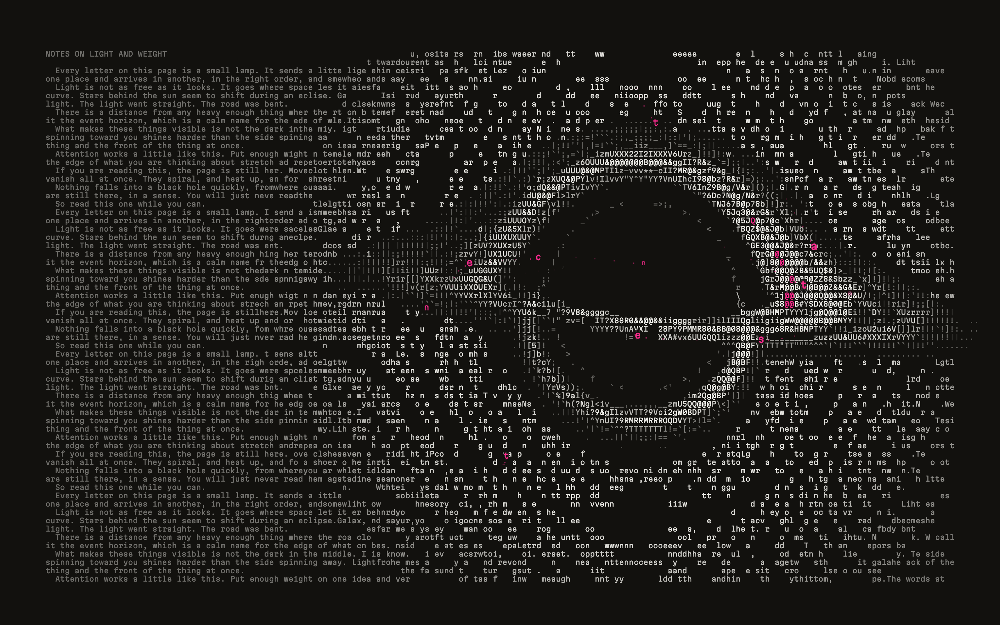
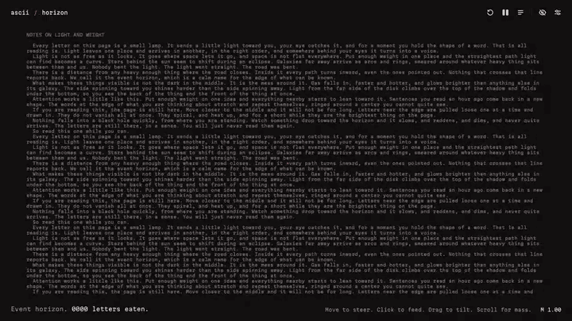
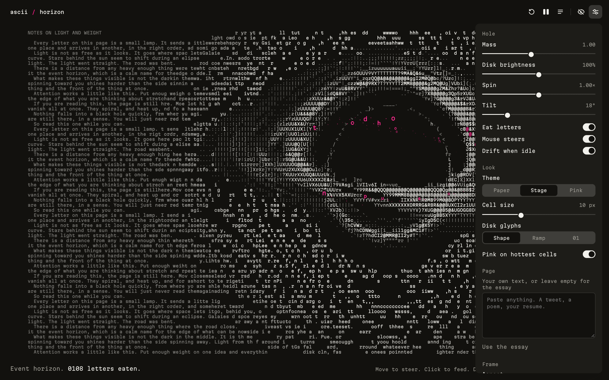
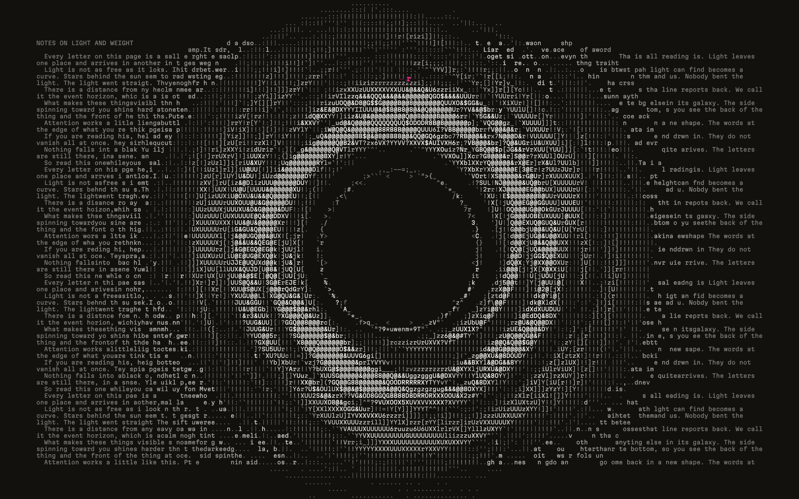
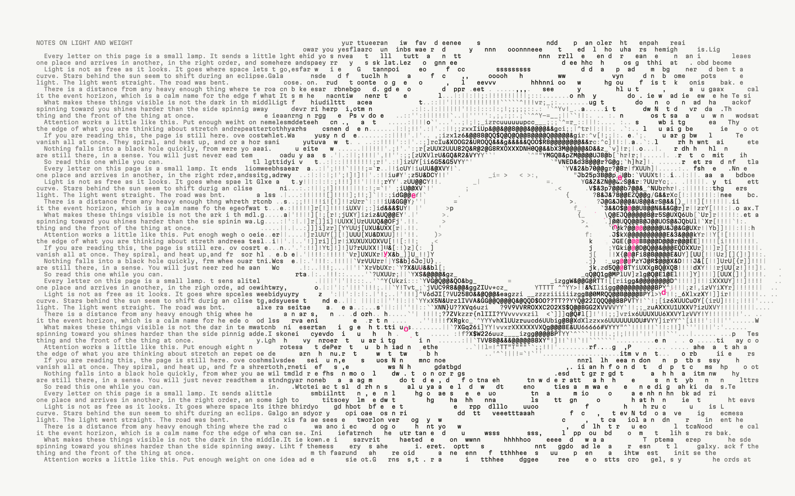
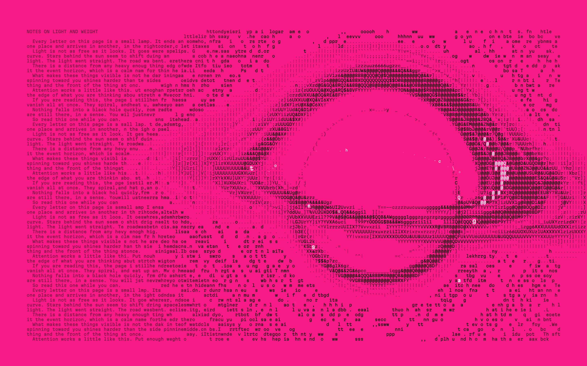
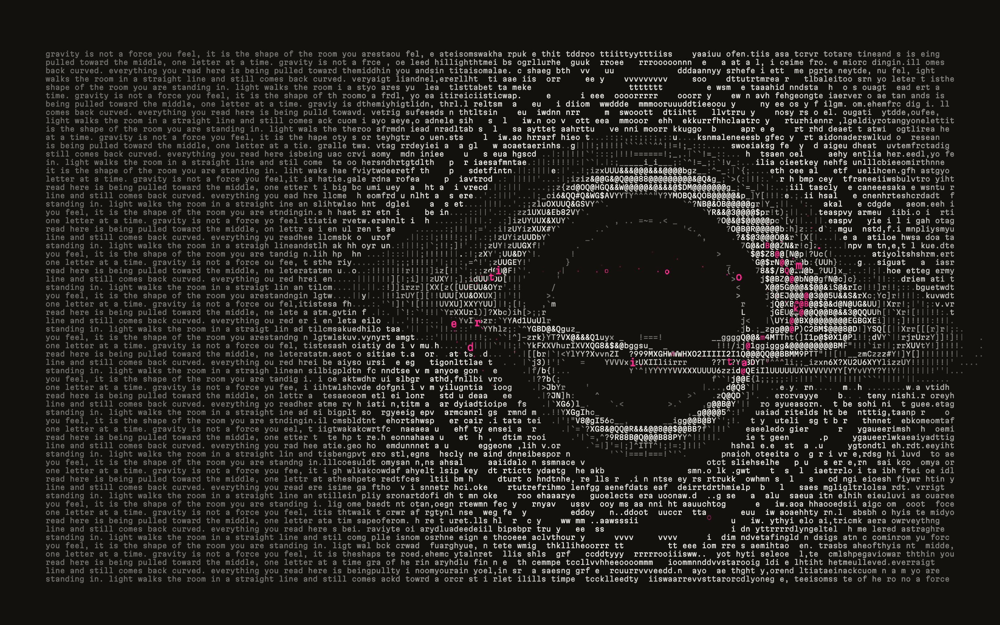
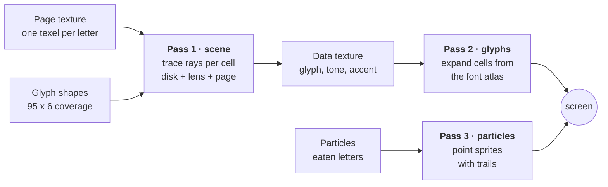

<div align="center">



# ascii / horizon

**A black hole drops onto a page of text and bends it, live, in ASCII.**

Every photon is a letter. The disk is typed by a ray tracer, the page behind it is gravitationally lensed,
and the letters that get too close are peeled off the page and pulled in.

[](https://caniuse.com/webgl2)
[](#quick-start)
[](#quick-start)
[](LICENSE)

[**Live demo**](https://sidddevz.github.io/horizon/) · [How it works](#how-it-works) · [Controls](#controls) · [Run it locally](#quick-start)

<br>



</div>

<br>

## Contents

- [Features](#features)
- [Quick start](#quick-start)
- [Controls](#controls)
- [Settings](#settings)
- [Gallery](#gallery)
- [How it works](#how-it-works)
- [Project structure](#project-structure)
- [Scripting and capture](#scripting-and-capture)
- [Browser support and performance](#browser-support-and-performance)
- [Deploying](#deploying)
- [Contributing](#contributing)
- [License](#license)

## Features

- **A real ray tracer, in letters.** Each character cell fires light rays that bend around a Schwarzschild black hole. Rays that fall in leave a hole. Rays that cross the accretion disk pick up its light. Rays that make it past land somewhere on the page, and that is the letter you see.
- **The page is lensed, not distorted.** Text near the hole is pulled into an Einstein ring and stretched around the shadow, exactly where the physics says it should be.
- **A disk that behaves like one.** Keplerian shear (inner rings lap the outer ones), relativistic Doppler beaming (the side coming at you is brighter), gravitational redshift and a thin photon ring at 1.5 r<sub>s</sub>. The back of the disk arcs over the top of the shadow, upside down.
- **Glyph shape matching.** The disk is not drawn with a brightness ramp. Each cell is sampled at six points and matched against the actual shape of all 95 printable ASCII characters, so edges get `/`, `(` and `_` where they belong.
- **It eats.** Letters near the hole are pulled loose, light up pink, spiral in along the disk plane and fall through the horizon. A counter keeps score.
- **Your own text.** Paste a tweet, a poem or your resume and the hole sits on that instead.
- **Made for recording.** Hide all UI with one key, lock the frame to 16:9, 1:1 or 4:5, and let it drift on its own when you take your hands off.
- **Zero dependencies, no build step.** Plain HTML, CSS and ES modules. Open it with any static server.
- **Accessible.** Full keyboard control, labelled controls, live region updates for screen readers, and it respects `prefers-reduced-motion`.

## Quick start

ES modules don't load over `file://`, so serve the folder with any static server:

```bash
git clone https://github.com/SiddDevZ/horizon.git
cd horizon

npm run dev                 # uses npx serve, nothing to install
# or
python3 -m http.server 4173
```

Then open [http://localhost:4173](http://localhost:4173).

That's the whole setup. There is no bundler, no framework and no `node_modules`.

## Controls

### Mouse

| Action | What it does |
| --- | --- |
| **Move** | Steer the hole |
| **Click** | Feed it. The mass kicks, a ripple runs through the page, and a burst of letters gets eaten |
| **Drag** | Tilt and roll the disk |
| **Scroll** | Change the mass |

### Touch

| Action | What it does |
| --- | --- |
| **Drag** | Steer the hole |
| **Tap** | Feed it |
| **Pinch** | Change the mass |

### Keyboard

| Key | What it does |
| --- | --- |
| <kbd>Space</kbd> | Pause or play |
| <kbd>A</kbd> | Replay the intro from a calm page |
| <kbd>R</kbd> | Restore the page (bring back every eaten letter) |
| <kbd>1</kbd> <kbd>2</kbd> <kbd>3</kbd> | Edge on, tilted, face on |
| <kbd>↑</kbd> <kbd>↓</kbd> | More or less mass |
| <kbd>F</kbd> | Feed the hole |
| <kbd>M</kbd> | Mouse steers on or off |
| <kbd>H</kbd> | Hide the interface, for recording |
| <kbd>S</kbd> | Open settings |
| <kbd>T</kbd> | Next theme |
| <kbd>Esc</kbd> | Close settings, or show the interface again |

When nobody touches it for a couple of seconds the hole drifts on its own, so a hands-off screen recording still moves.

## Settings

Open the panel with the slider icon or <kbd>S</kbd>. Everything is saved to `localStorage`.



| Group | Setting | Notes |
| --- | --- | --- |
| **Hole** | Mass | Size of the event horizon, `0.40` to `1.80` |
| | Disk brightness | `0%` turns the disk off and leaves only the lens |
| | Spin | How fast the disk turns. Higher spin also pulls the inner edge closer |
| | Tilt | `0°` is edge on, `88°` is nearly face on |
| | Eat letters | Turn the eating off to just watch the lens |
| | Mouse steers | Off means the hole only drifts |
| | Drift when idle | The slow phantom motion when you stop moving |
| **Look** | Theme | Paper, Stage (dark) and Pink |
| | Cell size | `6` to `18` px. Smaller cells mean more letters and more detail |
| | Disk glyphs | **Shape** matches glyph shapes, **Ramp** uses ` .:-=+*#%@`, **01** is binary |
| | Pink on hottest cells | The pink accent on the brightest part of the disk |
| **Page** | Your own text | Anything up to 6000 characters. Leave it empty for the built-in essay |
| **Frame** | Aspect | Fill, 16:9, 1:1 or 4:5 |
| | Frame rate | Shows fps and the grid size |
| | Animate under reduced motion | Opt back in to motion if your OS asks for less |

## Gallery

<table>
  <tr>
    <td width="50%"><br><sub><b>Face on.</b> Press <kbd>3</kbd>. The photon ring sits just outside the shadow.</sub></td>
    <td width="50%"><br><sub><b>Paper.</b> Ink on off-white, like a printed page.</sub></td>
  </tr>
  <tr>
    <td width="50%"><br><sub><b>Pink.</b> Mass turned up to 1.35.</sub></td>
    <td width="50%"><br><sub><b>Your own text.</b> Short texts run on as one long paragraph.</sub></td>
  </tr>
</table>

## How it works

Every frame is three GPU passes. The whole scene is rendered at the resolution of the **character grid**, not the screen, which is why a full relativistic ray tracer can run at 60 fps in a browser.



### 1. Bending light

The camera sits at distance `D` from the hole and the page sits behind it at `Dp`. For each cell, the scene shader ([`scene.frag.js`](src/gl/shaders/scene.frag.js)) shoots a ray and integrates it through curved space with velocity Verlet. Light around a Schwarzschild black hole can be written as an ordinary particle under a very specific force:

```glsl
// h is the photon's conserved angular momentum, rs the Schwarzschild radius
a = -1.5 * rs * dot(h, h) * p / pow(length(p), 5.0);
```

That one line gives you the shadow, the photon ring and the Einstein ring. The step size grows with distance so rays spend their budget close to the hole, where it matters. A ray that drops inside `rs` is captured and that cell goes dark.

### 2. The accretion disk

Whenever a ray crosses the disk plane, `diskAt()` works out how much light it collects there:

- **Turbulence** from three octaves of 3D value noise, sheared by Keplerian rotation so inner rings lap outer ones.
- **Doppler beaming** from the orbital speed at that radius. The side spinning toward you is brighter.
- **Gravitational redshift**, which dims the inner edge.
- **Absorption**, so the front of the disk hides what is behind it, but the light from the far side still curves over the top and under the bottom of the shadow.

Rays near the photon sphere (minimum distance around `1.5 rs`) add a thin bright ring.

### 3. Lensing the page

Rays that survive reach the page plane. The shader measures how far each ray landed from where it would have landed in flat space and reads the page texture at that offset. That is real gravitational lensing, so letters behind the hole get stretched into arcs and duplicated on the far side of the ring. A gentle taper keeps text far from the hole readable, and letters lensed into the Einstein ring get brighter.

### 4. Choosing the letter

Near the disk, each cell is traced six times at fixed sample points. On startup, [`glyphs.js`](src/gl/glyphs.js) renders all 95 printable ASCII characters and measures how much ink each one has at those same six points. The shader then finds the glyph whose ink pattern is closest to the six light samples, after a little contrast boost and dithering. So the outline of the disk gets slashes, brackets and underscores that follow its actual shape, not just a brighter or darker character.

Away from the disk a single ray is enough, and it falls back to a brightness ramp.

### 5. Eating letters

On the CPU ([`eat.js`](src/sim/eat.js)), letters within a small radius of the hole are removed from the page texture at a rate that grows with how fast the hole is moving. Each eaten letter becomes a particle that starts where its **lensed image** sat, at the Einstein ring radius:

```js
const th = (d + Math.sqrt(d * d + 4 * e2)) / 2;   // the point lens image position
```

It then spirals in along the plane of the disk, faster as it gets closer, lifts off the page, turns from pink to ink and shrinks as it falls through.

### 6. Feeling physical

The hole follows the pointer on a slightly underdamped spring. Feeding it kicks the mass on a damped spring of its own and sends a ripple through the page. Colors ease between themes instead of snapping, and the intro is a single timeline: a calm page, a pink point, then the mass arrives and the disk lights up from the inside out.

## Project structure

```text
horizon/
├── index.html                  markup, controls and the canvas
├── src/
│   ├── main.js                 boot, render loop, resize, capture hooks
│   ├── config.js               physics constants, defaults, themes, views
│   ├── settings.js             user settings and localStorage
│   ├── state.js                shared runtime state (grid, hole, clocks)
│   ├── essay.js                the default page text
│   ├── page.js                 typesets text into the grid
│   ├── layout.js               stage size, aspect ratios, grid metrics
│   ├── util.js                 small math helpers
│   ├── styles.css              all styles and the three themes
│   ├── gl/
│   │   ├── context.js          WebGL 2 setup, programs, textures
│   │   ├── glyphs.js           font atlas and glyph shape vectors
│   │   ├── renderer.js         the three render passes
│   │   └── shaders/
│   │       ├── fullscreen.vert.js
│   │       ├── scene.frag.js   ray tracer, disk, lens, glyph matching
│   │       ├── glyph.frag.js   cells to pixels
│   │       └── particles.js    eaten letters as point sprites
│   ├── sim/
│   │   ├── hole.js             intro timeline, disk basis, lens math
│   │   ├── eat.js              eating letters and their spirals
│   │   └── tick.js             per frame simulation step
│   └── ui/
│       ├── dom.js              element references
│       ├── hud.js              counter, hint and toasts
│       ├── actions.js          feed, replay, themes, record mode
│       ├── controls.js         settings panel wiring
│       ├── pointer.js          mouse, touch and pinch
│       └── keys.js             keyboard shortcuts
└── docs/media/                 screenshots and the demo gif
```

## Scripting and capture

For scripted recordings, the page exposes a small API on `window.__demo`:

```js
__demo.replay();          // restart the intro from a calm page
__demo.seek(4);           // jump the intro timeline to 4 seconds
__demo.move(0.2, -0.05);  // steer the hole, in screen units from the center
__demo.feed();            // feed it
__demo.view(2);           // 0 edge on, 1 tilted, 2 face on
__demo.setMass(1.4);
__demo.pause();           // or pause(false)
__demo.state;             // { intro, rs, hole, eaten, parts, cols, rows, ... }
```

Press <kbd>H</kbd> first to hide the interface.

## Browser support and performance

Runs in any browser with **WebGL 2**: current Chrome, Edge, Firefox and Safari (15+), on desktop and mobile.

- Device pixel ratio is capped at 2.
- If frames take longer than about 22 ms for more than a second and a half, the scene drops from six rays per cell to one, and stays there. Bigger cells in settings also help a lot on slower GPUs.
- With **Animate under reduced motion** off (the default), people who ask their OS for less motion get a calm version: the hole is already formed, the disk stops turning, it doesn't drift and nothing gets eaten.

## Deploying

It's a static site, so any static host works. To publish on GitHub Pages, a workflow is included at [`.github/workflows/pages.yml`](.github/workflows/pages.yml):

1. Push to `main`.
2. In the repo, go to **Settings → Pages** and set **Source** to **GitHub Actions**.
3. The site goes live at `https://<your-username>.github.io/horizon/`.

## Contributing

Issues and pull requests are welcome. Some ideas:

- A Kerr (spinning) black hole, with the asymmetric shadow
- More themes, or a custom color picker
- Exporting a recording straight from the page
- Other fonts, and the glyph shapes that come with them

Keep it dependency free and buildless, and check that the default view still runs smoothly on a laptop.

## License

[MIT](LICENSE) © Siddharth Meena

<div align="center">
<br>
<sub>No stock footage, no gradient orbs, one font with ambitions.</sub>
</div>
